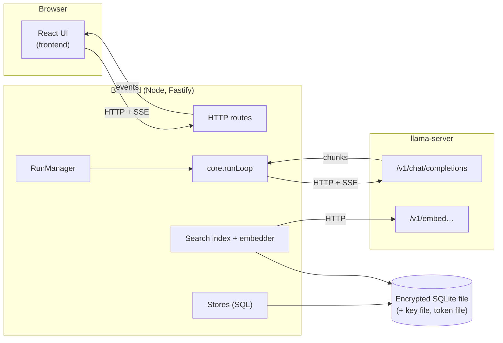
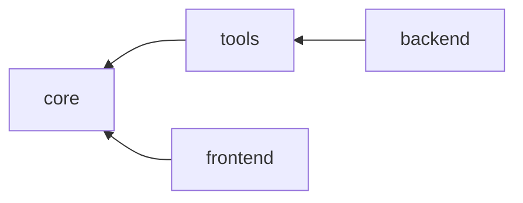

# Harness: Technical Documentation

The harness is a system for running LLM agents against a local
[llama.cpp](https://github.com/ggml-org/llama.cpp) `llama-server`. A user
chats with an agent in a browser UI. The agent can call tools, ask the user
questions, keep files and notes, work with structured data, and hand work to
other agents. Everything is stored in one encrypted SQLite database.

This documentation explains how the harness is built: what each part does,
and how the parts fit together.

## Reading order

| Document                                             | Read it to learn                                                                                         |
| ---------------------------------------------------- | -------------------------------------------------------------------------------------------------------- |
| [contributing.md](contributing.md)                   | New here? Set up, read in order, where code lives, and recipes for common changes.                       |
| [glossary.md](glossary.md)                           | What each term means (session, run, project, scope, and so on). Read this before the rest.               |
| [core.md](core.md)                                   | The framework-free engine: messages, events, the agent loop, tool definitions, the llama-server adapter. |
| [tools.md](tools.md)                                 | The tools an agent can call, and how a tool is written.                                                  |
| [backend.md](backend.md)                             | The server: run management, persistence, files, workspaces, MCP, the HTTP API, search, startup.          |
| [frontend.md](frontend.md)                           | The browser UI: how it loads state, follows live runs and answers prompts.                               |
| [how-it-works-together.md](how-it-works-together.md) | End-to-end walk-throughs: sending a message, approvals, subagents, reconnecting, crash recovery.         |
| [worked-example.md](worked-example.md)               | One real conversation traced step by step through every layer, from a debug export.                      |
| [DEVELOPMENT.md](DEVELOPMENT.md)                     | Requirements, running the app, multimodal models, environment variables, checks.                         |

## The system in one picture



- The **UI** never talks to llama-server. It talks only to the backend.
- The **backend** owns all state. It starts runs, stores every event, and
  streams events to the UI.
- **core** does the model-facing work: it turns a transcript into a model
  request, streams the response, runs tools, and emits events. It has no
  database, no HTTP server and no UI code.
- **llama-server** does inference. The backend reaches it at a configurable
  URL.

## Packages

The repository is a pnpm workspace with four packages.

```
packages/
  core/       @harness/core      messages, events, agent loop, tool API, llama-server adapter
  tools/      @harness/tools     every tool an agent can call
  backend/    @harness/backend   Fastify server, SQLite, run manager, migrations
  frontend/   @harness/frontend  React + Mantine UI (Vite)
```

Dependencies point one way

| Package    | Depends on      | Runtime                |
| ---------- | --------------- | ---------------------- |
| `core`     |                 | Any JavaScript runtime |
| `tools`    | `core`          | Node                   |
| `backend`  | `core`, `tools` | Node 22.22+            |
| `frontend` | `core`          | Browser                |



## Design principles visible throughout the code

- **The transcript is the source of truth.** A session's messages, in order,
  are stored. Session-scoped files, notes, schemas and data are not stored in
  tables of their own: they are rebuilt by replaying changes recorded on the
  messages.
- **Everything is an event.** A run communicates only by emitting events.
  The backend stores each event before sending it, so any client can replay
  what it missed.
- **Core depends on interfaces, the backend supplies implementations.** Core
  declares what a run needs (shared files, shared data, projects, agents,
  subagents, a schema checker, a search function). The backend implements
  those interfaces over SQL.
- **Everything the user can do, the model can do, and the reverse.** Files,
  notes, schemas, data, agents and skills are edited from the UI and by tools
  through the same stores, and every change is versioned and attributed.
- **Nothing is hard-deleted by accident.** Entries, agents, skills, schemas and
  data keep every version and are soft-deleted. Sessions and projects go to a
  trash first.

## Running it

Prerequisites: Node 22.22+, pnpm 10, and a running `llama-server` started with
`--jinja` (needed for tool calls).

```sh
pnpm install
pnpm dev:backend     # terminal 1: builds tools, then runs the backend with tsx watch
pnpm dev:frontend    # terminal 2: Vite dev server on http://localhost:5173
```

The backend prints a link of the form `http://localhost:5173/#token=…`. Open
it. The UI keeps the token for the browser tab and removes it from the address
bar.

Checks: `pnpm test` (Vitest), `pnpm typecheck`, `pnpm lint`, `pnpm format:check`.

### Backend configuration

Each setting can come from an environment variable, from the database
(editable in the Settings page), or from a built-in default. Precedence:
environment variable, then stored value, then default. Three values are read
before the database opens and can only come from the environment:

| Variable           | Default                                 | Meaning                              |
| ------------------ | --------------------------------------- | ------------------------------------ |
| `HARNESS_DATA_DIR` | `~/Library/Application Support/harness` | Folder for all backend files.        |
| `HARNESS_DB_PATH`  |                                         | The encrypted database. `harness.db` |
| `HARNESS_KEY_FILE` |                                         | The database key. `harness.key`      |

The remaining settings are listed in [backend.md](backend.md#settings).

### Important Files

| File           | Purpose                                                                    |
| -------------- | -------------------------------------------------------------------------- |
| `harness.db`   | The encrypted SQLite database (plus its WAL files).                        |
| `harness.key`  | The database key, 64 hex characters, mode `600`.                           |
| `api.token`    | The API token, 64 hex characters, mode `600`. Stable across restarts.      |
| `backend.json` | `{ pid, port, token }` for the running backend. Removed on clean shutdown. |
