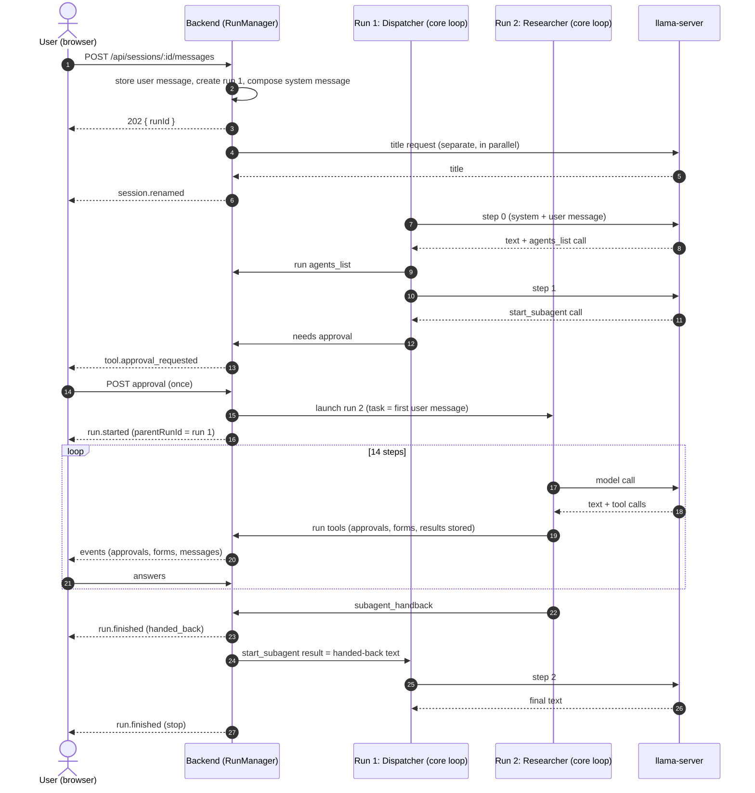

# Worked Example: One Conversation, Start to Finish

This document follows one real conversation through every layer of the harness.
It uses a debug export of a session (Session → Debug → copy) in which a user asks
for help learning to bowl. The Dispatcher agent hands the work to the Researcher
agent as a subagent. The Researcher hits tool errors, asks for approvals, fills in
forms, is reminded to hand back, asks the user a question, saves a file and finally
hands back.

Each step names the event, message and code path involved. Read
[glossary.md](glossary.md) first if a term is unfamiliar. The general mechanisms
are described in [how-it-works-together.md](how-it-works-together.md); this
document shows them all happening in one session.

## The conversation in numbers

| Fact           | Value                                                               |
| -------------- | ------------------------------------------------------------------- |
| Model          | `gemma-4-E4B-it-Q8_0` (for both runs and the title)                 |
| Project        | none                                                                |
| Runs           | 2: the Dispatcher's (top-level) and the Researcher's (subagent)     |
| Messages       | 35 (6 in the Dispatcher's run, 29 in the Researcher's)              |
| Model calls    | 3 for the Dispatcher, 14 for the Researcher, 1 for the title        |
| Tool calls     | 2 for the Dispatcher, 13 for the Researcher                         |
| Prompts        | 2 approvals, 3 forms (one an `ask_user` form), all answered         |
| Tool errors    | 2 (both `data_create` calls, both rejected before any approval)     |
| Wall-clock run | 02:08:56 to 02:16:34, about 7 minutes 38 seconds, mostly user waits |

## The cast

| Run | Agent         | Level     | Tools offered | Why that many                                                                            |
| --- | ------------- | --------- | ------------- | ---------------------------------------------------------------------------------------- |
| 1   | Dispatcher v1 | top-level | 14            | 3 in its grant (`ask_user`, `agents_list`, `start_subagent`) + 11 always-on tools        |
| 2   | Researcher v4 | subagent  | 36            | 24 in its grant + 12 always-on tools (the file and memory tools, `skill_load`, handback) |

The always-on tools are the 10 file and memory tools (`files_list`, `files_read`,
`files_write`, `files_delete`, `files_search` and the five `memory_*` equivalents)
plus `skill_load`. The Researcher is also given `subagent_handback`, because it is a
child run; the Dispatcher is not, because `subagent_handback` is only available in
child runs. The Researcher has no `start_subagent`, because its grant does not
include it. See [tools.md](tools.md#where-each-tool-becomes-available) and
[backend.md](backend.md#which-tools-a-run-gets).

## The whole flow at a glance



## Phase 0: the user sends a message (02:08:56)

> **User:** I'm totally new to bowling but I'd like to learn. Maybe join a local league.

**Browser.** `Chat.tsx` calls `POST /api/sessions/:id/messages`. The body carries
the text and the session's current model, reasoning effort and agent (here the built-in Dispatcher).

**Backend.** `RunManager.sendMessage` runs in this order:

1. It checks that no run is active in the session.
2. It saves the model, effort and agent choices on the session.
3. It decides whether the session needs a title: auto-rename is on, the title is
   still the default and there is no earlier user message. Here it does.
4. It appends the user message to `messages` (the first of the 35).
5. It calls `launch`, which creates run 1 and returns at once. The HTTP answer is
   `202 { runId }`.
6. It starts the title job (see below). The job runs independently of the run.

**What `launch` builds.** The run row stores the exact `request`: the system
message and the tool definitions the model will see. That stored copy is where the
**System prompt** and **Tools** items in the debug export come from.

### The Dispatcher's system message

`launch` composes the system message from the pieces below, in this order, and
drops any that are empty:

| Piece                                      | In this capture                                                                                                                                                 |
| ------------------------------------------ | --------------------------------------------------------------------------------------------------------------------------------------------------------------- |
| Global system prompt (placeholders filled) | "You are an expert AI agent…", then `<skills>`, `<tools>`, the schemas paragraph with `<schemas>` and `<data>`, then `<rules>` ("Be concise in your responses") |
| Project prompt                             | none (no project)                                                                                                                                               |
| Agent prompt                               | The Dispatcher's: "You are the user's entry point…" with its six numbered steps                                                                                 |
| Files and memory instruction               | "You can keep information across conversations with two sets of tools…", ending "This conversation is in a project: no."                                        |
| Child line                                 | none (run 1 is top-level)                                                                                                                                       |

The global prompt places the four lists with `{{skills}}`, `{{tools}}`,
`{{schemas}}` and `{{data}}`, so the harness does not add a skills list of its own.
Three details show that the lists are built for this run:

- `<skills>` has six skills, the ones in scope for the Dispatcher.
- `<tools>` has the 14 tools the run offers, each as its name plus the first
  sentence of its description.
- `<schemas>` and `<data>` are **empty**. Schemas are listed only when the run
  offers a schema or data tool, and the Dispatcher has none.

### The title job

At 02:09:07 the browser receives `session.renamed` with the title "Bowling for
Beginners: Learning the Ropes", `source: "model"` and its own usage (68 prompt
tokens, 9 completion tokens). It is a separate model request made by
`autoRename`, not a step of the run, so it does not appear in run 1's usage. The
event has `runId: null` because it belongs to the session. The browser applies it
to the navbar and refetches the session lists. If the model call had failed, the
title would have been cut from the user's message instead.

## Phase 1: the Dispatcher looks up agents (02:09:26)

The run's first step makes one model request: the system message plus the user
message, with the 14 tool definitions. The model streams reasoning, text and one
tool call. The loop emits, in order:

`run.started` → `step.started` → `message.started` → `reasoning.delta` (many) →
`text.delta` (many) → `tool.called` → `message.finished` (finish reason
`tool_calls`) → `tool.result` → `step.finished`.

The assistant message holds three blocks: reasoning, the greeting text, and a
`tool_call` to `agents_list` with arguments `{}`. It is stored (as the session's second message) before `message.finished` is emitted, with `model`, agent name and
version, and usage (3,598 prompt and 347 completion tokens).

The loop runs `agents_list`, which never asks. The tool reads the agents through
`ctx.agents` and returns each agent's id, name, scope, description, tool list and
`subagent` flag. The result is stored as a `tool` message and `tool.result` is
emitted. Nine agents come back; only Evidence Auditor, Personal Assistant, Planner
and Researcher have `subagent: true`.

## Phase 2: the Dispatcher starts a subagent (02:10:00)

The second step (4,949 prompt tokens: the system message plus the three earlier
messages) picks the Researcher and calls `start_subagent` with its id and a task.

`start_subagent` has the approval default `ask`, and nothing in this session has
changed that. So, before executing it:

1. The loop emits `tool.approval_requested` (`requestId`, `callId`, `name`,
   `arguments`). This tool has no `review`, so there is no list of changes.
2. The backend stores the open request in the active run and waits on a promise.
3. The browser adds the request to `useLive` and `ApprovalDialog` opens, showing the
   tool name and the task text.
4. Five seconds later the user presses _Allow once_. The browser posts
   `{ choice: "once" }` to `/api/runs/:runId/approvals/:requestId`; the backend
   checks the choice, resolves the promise and the loop emits
   `tool.approval_resolved`.

The loop then calls the tool's `execute`. `start_subagent` calls
`ctx.subagents.start`, implemented by `RunManager.startChild`, and awaits it.

## Phase 3: run 2 is launched (02:10:05)

`startChild` calls `launch` again for the Researcher, with `parent = { runId: 1,
callId }`:

- A **new run row** is created with `parent_run_id` and `parent_call_id`.
- The **task text is saved as the child's first user message**. It belongs to run 2,
  and the export marks it "User · run 2 · subagent, depth 1". The child does not see
  the Dispatcher's conversation.
- `run.started` is emitted on the **same session stream**, with `parentRunId` and
  `parentCallId`. The browser adds a _child_ entry under run 1 instead of replacing
  it. The transcript shows a collapsible panel under the `start_subagent` call.
- The child gets its own system message and tool set, built the same way as before.

How the Researcher's system message differs from the Dispatcher's:

| Piece                  | Dispatcher    | Researcher                                                                                |
| ---------------------- | ------------- | ----------------------------------------------------------------------------------------- |
| Skills                 | 6             | 8 (`crawl-a-webpage` and `perform-research` are added)                                    |
| Tools                  | 14            | 36                                                                                        |
| `<schemas>`            | empty         | Decision, Goal, Task: the run has data tools                                              |
| `<data>`               | empty         | empty: no data exists yet                                                                 |
| Agent prompt           | routing steps | "You are an AI agent specializing in researching a given topic…" with six steps           |
| Last line (child line) | none          | "You are working on a task for another agent. When you are done, call subagent_handback…" |

The child line is the agent's `childPrompt`, or the global one when the agent has
none.

## Phase 4: two failures, then a reviewed write (02:10:50 to 02:11:41)

The Researcher's plan says to save a Goal first. It calls `data_create`.

### Attempt 1: wrong schema id

The model passed `schemaId: "Goal"`. The system message lists schemas by _name_,
but the tools take _ids_. `data_create` is a tool with `approval: "ask"` and a
`review` function, so the loop calls `review` **before** it would show a prompt.
Review found no schema with that id and returned an error result:

```json
{ "error": "No schema with the id \"Goal\" is available. Call schemas_list." }
```

The loop does not ask the user in that case. It stores the error as a `tool`
message (`isError: true`) and reports a `tool_returned_error` to the backend, which
records it in the `errors` table and tells every window (`errors.changed`). The
Errors page and the panel under the chat show it.

### Recovery

The next step (8,042 prompt tokens; the error is in the transcript, so the model
sees it) calls `schemas_list`. This tool never asks and returns the three built-in
schemas with their ids: `builtin-decision`, `builtin-goal` and `builtin-task`.

### Attempt 2: invalid value

With the right id the value is checked against the schema, and fails:

```
The value does not match version 1 of the schema "Goal":
- /status: must be one of "active", "blocked", "paused", "achieved", "dropped".
```

This follows the same path: review fails, an error result is stored, a second
error is recorded, and the user is not asked. The message names the field and the
allowed values, so the model can fix it in one step.

### Attempt 3: a reviewed write

With `status: "active"`, review succeeds, and it produces a **plan**: what the
call would create. Now the loop emits `tool.approval_requested` with a `review`:

```json
{
  "items": [
    {
      "key": "data",
      "label": "Goal \"Bowling Fundamentals and League Search\"",
      "changes": [
        { "path": "/name", "kind": "added", "after": "…" },
        { "path": "/description", "kind": "added", "after": "…" },
        { "path": "/value/goal", "kind": "added", "after": "…" },
        { "path": "/value/status", "kind": "added", "after": "active" }
      ]
    }
  ]
}
```

The browser's dialog lists the four field-level changes as checkboxes. The
Researcher's approval is **answered against run 2's id**, not run 1's. The user
chooses _Allow once_ about 15 seconds later. The loop emits `tool.approval_resolved`
and runs `data_create`, which writes the Goal into the **session**.

The result message for the new data (`ab11a800d4f72b59`) is the important part:

- `content`: what the model sees: the created data.
- `dataOps`: `[{ "op": "data_put", "id": "ab11a800d4f72b59", … "value": { … } }]`,
  which the model does **not** see.

The loop saves `dataOps` on the message only because the tool succeeded. Neither
failed attempt left anything behind.

## Phase 5: searching the web (02:11:54 and 02:12:08)

The Researcher writes its research questions in its reasoning, then calls
`web_search` twice: once for beginner fundamentals, once for how to find leagues
without a location. `web_search` never asks, so each is just a call and a result:

`tool.called` → `message.finished` → `tool.result`.

The tool returns DuckDuckGo Lite results as Markdown lines (`results_markdown`). The results are large (the next call's prompt is roughly 1,000 tokens bigger), and
they stay in the transcript, so every later model call includes them.

## Phase 6: two forms (02:12:35 and 02:13:25)

### `memory_add`

The tool's contract is "the model suggests and the user decides". It calls
`ctx.requestInput` with a form instead of saving straight away. The loop emits
`input.requested` with the form definition:

| Field      | Kind    | Notes                                                                  |
| ---------- | ------- | ---------------------------------------------------------------------- |
| `scope`    | choice  | `session` (suggested) or `global`: `project` is missing, there is none |
| `remember` | boolean | "Use this for my notes for the rest of this session", default off      |

The run pauses. The browser draws `AskUserForm` inline in the transcript at the
tool call. About seven seconds later the user presses _Save_, the browser posts the
answers to `/api/runs/:runId/inputs/:requestId`, the backend validates them with
`checkAnswers`, and the loop emits `input.resolved` (`outcome: "answered"`) and
continues.

`memory_add` then saves the note and returns `{ scope: "session", id }`. The stored
result also carries:

- `prompt`: the form's title and the user's answers, so the transcript can show
  what was asked and answered.
- `entries`: `[{ "op": "put", "kind": "note", "key": "239b4ec4e012302d", "value": "…" }]`.
  A session-scoped note exists **only** as this operation.

### `files_write` (new file)

The second form is the same mechanism with different fields: **Name**
(`bowling_beginner_guide.md`, pre-filled from the model's suggestion and checked
against the key pattern) and **Save to** (`session`). The result reports
`created: true`, and `entries` holds a `put` for the file with its whole value.

## Phase 7: stopping without handing back (02:13:53)

The next step ends with plain text and **no tool call**: the Researcher tells the
"user" it is done and asks for a location in prose. For a top-level run that would
end the run. For a subagent the loop does something else:

1. It remembers the text as the latest answer.
2. It checks `childReminders` (default 2, or the agent's own value).
3. It stores a **user message** in run 2: "You have not handed back. If you are
   finished, call subagent_handback with your result. If you need something from
   the user, call ask_user." and continues the loop. This counts as an iteration.

That is why the export shows the reminder as a "User · run 2" item. Once the
reminders are used up, the loop ends the child with the text it remembered. In this
capture the first reminder is enough: the model's next step is an `ask_user` call.

## Phase 8: asking the user (02:14:20)

The Researcher calls `ask_user` with a one-field JSON Schema. The loop reads it
with `readForm` and emits `input.requested` with a text field, "Please provide your
city and state, or your zip code, to find local bowling leagues." The form appears
inline in the chat. The user types "Iowa", and the result is `{"location":"Iowa"}`.

`ask_user` appears with approval default `never`: the form is the interaction.

## Phase 9: more research and an overwrite (02:14:39 to 02:15:53)

1. `web_search` for Iowa centres and leagues.
2. `files_read` for `bowling_beginner_guide.md` (never asks). The tool finds the key
   in the session and returns the whole value.
3. `files_write` with the same key. The file now exists in exactly one scope, so
   it is **saved there without a form**. The result reports `created: false`, and
   `entries` holds a second `put` with the whole new text.

There is no history for session files beyond the transcript: the two `put`
operations are the two versions.

## Phase 10: handing back (02:16:12)

The model writes a closing message and calls `subagent_handback` with an `output`
string. The tool returns `{ handedBack: true }` and a `handback` value. The loop:

1. stores the tool result message (the 29th message of run 2);
2. returns `handback` as the run's result with reason `handed_back`;
3. emits `run.finished` for run 2 with `reason: "handed_back"` and usage (146,547
   prompt tokens, 4,560 completion tokens, summed over its 14 calls).

`startChild` reports success to `start_subagent`, which returns
`{ agent: "Researcher", output: "…" }`. The pending call in run 1 now resolves, and
its result is stored as run 1's fifth message. The browser, on `run.finished` for a child, refetches the session
and removes the child entry; the panel under `start_subagent` now shows the
stored messages instead of live state.

## Phase 11: the Dispatcher answers (02:16:34)

Run 1's third step has 5,560 prompt tokens. Its request holds the system message
and exactly five messages: the user message, the `agents_list` call and result, the
`start_subagent` call and its result. **None of the 29 messages from run 2 are in
it**: the Researcher's working is invisible to the Dispatcher, which sees only the
`output` string.

The model writes a short summary and asks what the user wants next. No tool call,
no child: the loop emits `run.finished` with `reason: "stop"` and usage of 14,107
prompt and 1,250 completion tokens. That is the sum of run 1's own three calls, with
the child's 146,547 not counted. The UI clears the live entry and refetches the
session.

## What the session holds at the end

Session files, notes, schemas and data are not in tables. They are rebuilt from the
transcript by replaying every `entries` and `dataOps` operation in order
(`replaySessionEntries`, `replaySessionData`).

| Item        | Key or id                   | Built from                                                                  |
| ----------- | --------------------------- | --------------------------------------------------------------------------- |
| File        | `bowling_beginner_guide.md` | two `put` operations (`files_write` ×2); the second replaces the first      |
| Note        | `239b4ec4e012302d`          | one `put` (`memory_add`)                                                    |
| Data (Goal) | `ab11a800d4f72b59`          | one `data_put` (`data_create`); the two failed attempts contributed nothing |
| Title       | `sessions.title`            | set by the title job (`session.renamed`, source `model`)                    |

Because the operations live on the Researcher's messages (run 2), they are in the
session's full message list. The Dispatcher's next request will therefore list the
Goal in `<data>` if the run offers a data tool, and the Files tab will show the guide
even though the file was written by a child.

Elsewhere in the database:

| Where      | What this conversation put there                                                               |
| ---------- | ---------------------------------------------------------------------------------------------- |
| `sessions` | One row: title, agent (Dispatcher), model                                                      |
| `messages` | 35 rows; `run_messages` links each to run 1 or run 2                                           |
| `runs`     | 2 rows. Run 2 has `parent_run_id` and `parent_call_id`. Both store their `request` and `usage` |
| `events`   | About 4,000 rows, mostly streaming deltas. The export leaves those out                         |
| `errors`   | 2 rows (`tool_returned_error` for the two `data_create` calls)                                 |

## Token accounting

Each assistant message records the usage of the model call that produced it. A run's
usage is the sum of its own calls.

| Run | Call | Tool or ending      |  Prompt | Completion |
| --- | ---- | ------------------- | ------: | ---------: |
| 1   | 0    | `agents_list`       |   3,598 |        347 |
| 1   | 1    | `start_subagent`    |   4,949 |        547 |
| 1   | 2    | stop                |   5,560 |        356 |
|     |      | **Run 1 total**     |  14,107 |      1,250 |
| 2   | 0    | `data_create`       |   7,629 |        377 |
| 2   | 1    | `schemas_list`      |   8,042 |         82 |
| 2   | 2    | `data_create`       |   8,270 |        222 |
| 2   | 3    | `data_create`       |   8,552 |        253 |
| 2   | 4    | `web_search`        |   8,909 |        198 |
| 2   | 5    | `web_search`        |   9,984 |        171 |
| 2   | 6    | `memory_add`        |  10,814 |        384 |
| 2   | 7    | `files_write`       |  11,236 |        716 |
| 2   | 8    | stop (no handback)  |  11,992 |        343 |
| 2   | 9    | `ask_user`          |  10,799 |        256 |
| 2   | 10   | `web_search`        |  11,076 |        208 |
| 2   | 11   | `files_read`        |  12,191 |        285 |
| 2   | 12   | `files_write`       |  13,099 |        816 |
| 2   | 13   | `subagent_handback` |  13,954 |        249 |
|     |      | **Run 2 total**     | 146,547 |      4,560 |

The prompt figure is what llama-server reports for that request. Each model call
re-sends the run's whole transcript, so the figure generally grows as results
accumulate. It is whatever the server reports, though, and it does not rise on every
call (call 9 is lower than call 8).

## Summary: who did what

| Layer        | What it did in this conversation                                                                                                                               |
| ------------ | -------------------------------------------------------------------------------------------------------------------------------------------------------------- |
| Browser      | Sent the message; showed streaming text; drew two approval dialogs and three inline forms; showed the child run in a panel; refetched on each `run.finished`   |
| HTTP routes  | Accepted the message (202), the two approvals and the three form answers; served the session snapshot and event stream                                         |
| `RunManager` | Built two system messages and tool sets; created two runs; kept open approvals and forms; started the child; recorded two tool errors; ran the title job       |
| Core loop    | Ran 3 + 14 model calls; validated and reviewed tool calls; paused for approvals and forms; reminded the child; ended it on handback                            |
| Tools        | Did every action through `ctx` interfaces: agent list, session data and files, notes, the web                                                                  |
| llama-server | Answered 18 requests (17 for the runs, 1 for the title)                                                                                                        |
| Database     | Stored every message and event before the browser saw it, so a reload at any moment (including during a form) would have restored the screen from the snapshot |
